  

---

## / ABOUT

A Python developer passionate about Artificial Intelligence and Machine Learning. I build practical projects, train and evaluate models, and explore AI across its major domains.

## / INTERESTS

- Artificial Intelligence
- Machine Learning
- Deep Learning
- Natural Language Processing
- Computer Vision
- Generative AI

## / TECH STACK

**Programming**

**Development Tools**

**Focus Areas**

Model Training · Model Evaluation · AI Development · Python Applications

## / GITHUB STATS

  
  

## / CONNECT

---

  Evolving through code, logic, and intelligent systems.

